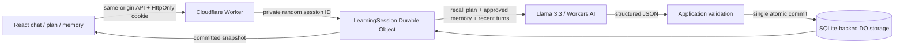

# Waypoint

**A little curiosity. A world of possibility.**

An AI learning companion built on Cloudflare. Tell it what you want to learn, create a manageable plan, work through concepts in chat, and keep your progress and learning preferences between visits.

**Hosted app:** [cf-ai-waypoint.cf-ai-waypoint.workers.dev](https://cf-ai-waypoint.cf-ai-waypoint.workers.dev)

**Source repository:** [nitin2306/cf-ai-waypoint](https://github.com/nitin2306/cf-ai-waypoint)

## Assignment requirements

| Requirement             | Implementation                                                                                                                                                                                                               |
| ----------------------- | ---------------------------------------------------------------------------------------------------------------------------------------------------------------------------------------------------------------------------- |
| LLM                     | Llama 3.3 70B through the Workers AI `AI` binding (`@cf/meta/llama-3.3-70b-instruct-fp8-fast`).                                                                                                                              |
| Workflow / coordination | A Worker routes a private session to its Durable Object. The object coordinates recall → inference → validation → atomic persistence, and rejects overlapping mutations.                                                     |
| User input              | Responsive React chat, hosted with Workers Static Assets on the same origin as the API.                                                                                                                                      |
| Memory / state          | SQLite-backed Durable Object storage persists chat, an active learning plan, completion state, and user-approved memories.                                                                                                   |
| AI prompt history       | [PROMPTS.md](PROMPTS.md) records the user prompts supplied during implementation and describes autonomous implementation choices. The exact runtime system prompt and JSON schema are in [worker/model.ts](worker/model.ts). |

Workers and Durable Objects meet the coordination requirement; a separate Cloudflare Workflows resource is not required. This app uses a plain Durable Object rather than adding the Agents SDK: one object already supplies the identity, storage, and turn coordination this use case needs.

## Run without credentials

Requires Node.js 22.12+ and npm.

```sh
git clone https://github.com/nitin2306/cf-ai-waypoint.git
cd cf-ai-waypoint
npm ci
npm run dev:demo
```

Open **http://127.0.0.1:8787**. The **Local preview** badge means the app uses deterministic example responses, not an LLM. The Worker, Durable Object, API, memory, progress, and browser session are real and run locally. There is no silent demo fallback in live mode. Local state lives in `.wrangler/state/` and is not uploaded to production.

This command builds the client before starting Wrangler. After editing client files, restart it or run `npm run build` again.

## Run with real Workers AI

You need a Cloudflare account with Workers AI enabled. The AI binding performs remote inference even during local development; usage counts against your account's allowance.

```sh
npx wrangler login
npm run dev
```

The default configuration explicitly sets `DEMO_MODE` to `false`, binds Workers AI remotely, and runs the session Durable Object locally. No external LLM API key is required. If inference fails, the UI shows an error and offers a retry; it never substitutes a canned answer.

## Deploy to Cloudflare

```sh
npx wrangler login
npm run deploy
```

Wrangler publishes the client, Worker, and SQLite-backed Durable Object migration together and prints the deployment URL. No D1 database creation, Pages project, or manual SQL migration is needed. Change `name` in `wrangler.jsonc` if that name is already in use. The root config is the live configuration; do not deploy `wrangler.demo.jsonc` for the assignment.

After deployment, verify the hosted application and real inference:

```sh
npm run verify:deployed -- https://your-worker.your-subdomain.workers.dev
```

This creates a fresh anonymous test session, runs two live model calls, checks plan generation and memory recall, verifies progress after browser reload, and cleans up its own workspace. It requires Google Chrome and uses your Workers AI allowance.

On a corporate network where Node does not automatically use the configured proxy and system certificate store, run Wrangler with `NODE_USE_ENV_PROXY=1 NODE_USE_SYSTEM_CA=1` using a current Node release. This preserves TLS verification.

For a packaging check without publishing:

```sh
npm run deploy:dry
```

No hosted deployment or actual Workers AI inference is implied by a successful local preview or dry run. See [VALIDATION.md](VALIDATION.md) for the checks performed in this workspace.

## A two-minute walkthrough

1. Choose **Find my starting point** and send the prefilled prompt. In live mode, try “Make me a seven-day plan to learn Cloudflare Workers. I have 30 minutes a day.”
2. Open **Learning plan**. Mark a step complete, then reload. The completion state survives.
3. Open **Memory** and save “I learn best with practical examples.” It now appears in the context panel and will be included in subsequent inference.
4. Ask “Explain Durable Objects with a simple analogy.” The model receives your preferences, current plan, and recent chat. Existing progress is protected during follow-ups. To replace a plan, enable **Replace learning plan with this message** in the composer before sending a new goal.
5. Ask “Quiz me on the next incomplete step.” A follow-up does not need to repeat the original goal.
6. Start a **New conversation**: chat clears, while your plan and memory remain. Export or erase all workspace content in **Memory**.

Preview mode demonstrates the same persistence and controls with fixed examples. It does not generate topic-specific plans or grade answers.

## Architecture



`worker/index.ts` handles session routing, request validation, turn coordination, inference, and persistence. `worker/model.ts` owns the system prompt, response schema, output validation, and explicitly selected demo responder. `src/main.tsx` supplies the UI, client state, and workspace controls. `src/types.ts` shares the API types.

The model may return a Markdown reply, a new plan, and an optional memory suggestion. Each response is validated before any conversation or plan change is saved. A suggested memory is **not** saved until the user accepts it. Once a plan exists, the server ignores replacement plans unless the user explicitly enables replacement for that message. Follow-up responses therefore cannot reset saved progress, even when the model returns an unwanted plan. Review a newly generated plan before using it.

## State and failure behavior

- Each browser receives a random, server-generated session cookie. It is HttpOnly, SameSite=Strict, and Secure on HTTPS; it is never accepted from a URL. This is a bearer session, not account authentication. Clearing the cookie loses access, and there is no cross-device sync.
- Chat retains the latest 100 messages. Inference uses the latest 12 messages plus the active plan and up to 20 approved memories; this is explicit structured memory, not vector search or an unlimited context window.
- Input is limited to 4,000 characters; memory notes to 240. JSON bodies are capped at 20 KB. Mutations require a same-origin `Origin` header.
- Each session allows 30 inference attempts per hour. This is an application guard, not an account-wide abuse defense: fresh cookies can create fresh sessions. Put the deployed app behind Cloudflare Access or add Turnstile/global rate limits before opening an unrestricted public demo.
- A session accepts one mutation at a time. Reads return the last committed snapshot. Invalid output and failed inference do not commit a partial turn. A 45-second timeout returns a retryable error; it does not cancel an already submitted provider request.
- A client-generated message ID deduplicates retries while that message remains in the retained history. The app does not automatically retry model calls or claim exactly-once inference after a runtime failure.
- “New conversation” deletes chat only. “Erase workspace” deletes chat, plan, and memory; the rate-limit counter remains. Forgetting a memory stops future explicit recall but does not delete that text from existing chat messages.
- Durable storage survives normal object eviction. This synchronous request pipeline does not checkpoint in-flight inference or resume it after a process failure. Long-running, resumable tasks would be a reason to introduce Cloudflare Workflows.

## Verification

```sh
npm run check       # TypeScript, model-boundary tests, production frontend build
npm run test:e2e    # Real local Worker + Durable Object + Chrome
npm run deploy:dry # Bundle and binding/migration validation, no publish
```

The browser tests use an installed Google Chrome (`channel: 'chrome'`). If Chrome is unavailable, install it or change the channel in `playwright.config.ts` and install Playwright Chromium. End-to-end coverage includes chat → generated plan → saved progress → memory → reload → export → erase, session isolation, input validation, retry deduplication, same-origin enforcement, and a narrow mobile viewport. These tests exercise preview mode; model quality and real-account deployment require live verification.

## Documentation used

- [Cloudflare Agents overview](https://developers.cloudflare.com/agents/)
- [Llama 3.3 model and Workers AI binding API](https://developers.cloudflare.com/workers-ai/models/llama-3.3-70b-instruct-fp8-fast/)
- [Workers AI JSON mode](https://developers.cloudflare.com/workers-ai/features/json-mode/)
- [Durable Objects getting started and SQLite storage](https://developers.cloudflare.com/durable-objects/get-started/)
- [Workers Static Assets configuration](https://developers.cloudflare.com/workers/static-assets/binding/)

AI-assisted implementation. Review [PROMPTS.md](PROMPTS.md) alongside the code before submitting. Include the hosted URL above and append any further prompts or modifications to your final submission.
